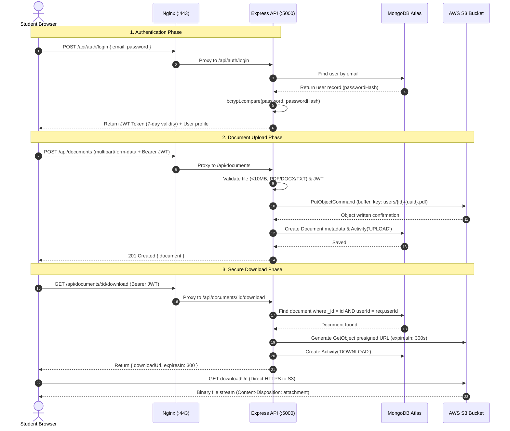

# StudyVault — System Architecture & Cloud Design

## 1. Executive Summary

StudyVault is an academic document and notes management system built using the MERN stack (MongoDB Atlas, Express.js, React, Node.js) and AWS Cloud services (Amazon EC2, Amazon S3, AWS IAM). The application provides multi-tenant student data isolation, academic file storage in private S3 buckets, temporary presigned download URLs, real-time activity tracking, and analytical dashboard metrics.

---

## 2. End-to-End System Architecture

```mermaid
graph TD
    User["Student Browser (Chrome / Edge / Safari)"] -->|HTTPS :443 TLS 1.2/1.3| Nginx["Nginx Reverse Proxy & Static Server (Docker)"]
    User -.->|HTTP :80| Redirect["HTTP 301 Redirect to HTTPS"]
    Redirect -.-> User

    subgraph "AWS EC2 Host (Amazon Linux 2023 - Sydney ap-southeast-2)"
        subgraph "Docker Bridge Network (studyvault_default)"
            Nginx -->|Static Assets / SPA Fallback| Dist["React Vite Build (/usr/share/nginx/html)"]
            Nginx -->|Proxy Pass /api/* (HTTP :5000)| Backend["Node.js Express API Container (Port 5000)"]
        end
        Backend -->|IAM Instance Profile: StudyVaultEC2Role| AWS_IMDS["AWS EC2 IMDSv2 (Temporary Credentials)"]
    end

    subgraph "Database Tier (Cloud Managed)"
        Backend -->|TLS Mongoose Connection| Atlas[("MongoDB Atlas M0 Cluster")]
    end

    subgraph "Storage Tier (AWS S3)"
        Backend -->|PutObject / DeleteObject (IAM Auth)| S3Bucket[("Private S3 Bucket: studyvault-priti-documents-2026")]
        Backend -->|Generate Presigned GET URL (expiresIn: 300s)| User
        User -->|Direct Authorized Download via HTTPS| S3Bucket
    end
```

---

## 3. Component Responsibilities

### 3.1 Client Layer (Frontend SPA)
- **Framework**: React 18 + Vite 5 + Lucide Icons.
- **Styling**: Curated dark-mode design system with responsive layouts and accessible form controls.
- **State Management**:
  - `AuthContext`: Manages JWT authentication state, token persistence in `localStorage`, and session validation on page refresh via `GET /api/auth/me`.
  - `ToastContext`: Global notifications for asynchronous operations (uploads, deletions, favorites).
- **Views**:
  - `DashboardView`: Aggregated statistics, storage usage breakdown, categorized document metrics, and recent activities.
  - `DocumentsView`: Debounced search, category filter, semester filter, favorite toggle, pagination, and file actions.
  - `ActivityView`: Audit log of user operations (`UPLOAD`, `DOWNLOAD`, `UPDATE`, `DELETE`, `FAVORITE`, `UNFAVORITE`).

### 3.2 Gateway Layer (Nginx Reverse Proxy)
- **Container**: `studyvault-frontend` (`nginx:alpine`).
- **Ports**: 80 (HTTP) and 443 (HTTPS).
- **SSL/TLS**: Terminated with Let's Encrypt certificates managed via Certbot webroot challenges.
- **Routing**:
  - `/` &rarr; Serves compiled React static assets (`/usr/share/nginx/html`) with `try_files $uri $uri/ /index.html;` for client-side routing.
  - `/api/` &rarr; Reverse-proxies to `http://backend:5000` over the internal Docker network.
  - `/.well-known/acme-challenge/` &rarr; Certbot renewal validation directory (`/var/www/certbot`).
- **Security & Limits**:
  - `server_tokens off;` suppresses web server version disclosure.
  - `client_max_body_size 15M;` enables student uploads up to 10 MB.
  - Security headers enforce `X-Content-Type-Options: nosniff` and `X-Frame-Options: DENY`.

### 3.3 Application Server Layer (Express Backend API)
- **Container**: `studyvault-backend` (`node:20-alpine`).
- **Process**: Runs as non-root user `node`.
- **Port**: Bound internally to `127.0.0.1:5000:5000` (accessible via loopback on host and internal Docker bridge).
- **Security Middleware**:
  - `helmet`: Security HTTP headers (CSP, HSTS, X-Content-Type-Options, Frameguard).
  - `cors`: Strictly whitelists allowed origins in production (`studyvault-priti.duckdns.org`).
  - `express-rate-limit`: Brute-force protection on auth endpoints (15 req/15 min) and API general limiter (100 req/15 min).
  - `morgan`: Audit logging with IP masking and request status tracking.

### 3.4 Database Layer (MongoDB Atlas)
- **Provider**: MongoDB Atlas Replica Set (AWS Sydney region).
- **Collections**:
  - `users`: User identity, email (case-insensitive indexed), and bcrypt password hashes.
  - `documents`: Document metadata (`originalFileName`, `s3Key`, `mimeType`, `fileSize`, `subject`, `semester`, `category`, `tags`, `isFavorite`, `userId`).
  - `activities`: Audit log entries (`userId`, `documentId`, `action`, `fileName`, `createdAt`).
- **Data Isolation**: Strict multi-tenant tenancy filtering (`{ userId: req.userId }`) on every query and mutation.

### 3.5 Storage Layer (Amazon S3)
- **Bucket**: `studyvault-priti-documents-2026` (`ap-southeast-2` Sydney).
- **Access Policy**: Private bucket with Block Public Access enabled across all four S3 settings.
- **Key Partitioning**: Structured as `users/{userId}/{uuid}{extension}` to ensure collision resistance and namespace isolation.
- **Authentication**: AWS IAM Role (`StudyVaultEC2Role`) via EC2 Instance Profile; no long-term access keys stored on disk.
- **File Retrieval**: Downloads are executed exclusively via temporary presigned GET URLs generated with a 5-minute (300 seconds) expiration window.

---

## 4. Authentication and Document Access Flow


